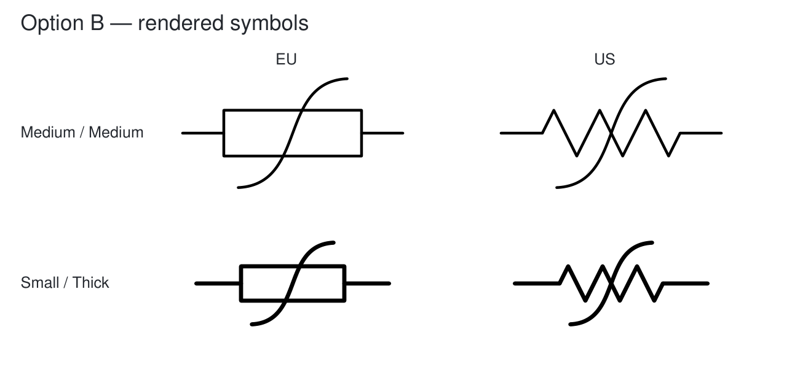
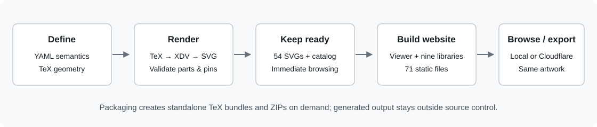

# Develop Schematica

[Preview](https://schematica-preview.dinodubroja.workers.dev/)
· [Inkscape](docs/INKSCAPE.md)
· [Scope and gaps](docs/ROADMAP.md)
· [Current status](context/CURRENT.md)

## Latest changes

14-11-2026: **selected nonlinear option B, 18 approvals applied, tapped resistors
removed**. The library has **26 designs / 342 configurations**: **24 Verified** and
two revised nonlinear designs **Unverified**. Those two are revision 3.

Option B uses one smooth cubic curve, with no centre join. Both body appearances
match the option selected in chat at every size/stroke. Bodies, leads and pins stay
fixed; every retained approved SVG is byte-identical to the previous library.



**Build: `ee70ffede6be`.** Source synchronization to GitHub is authorized for this
update. Cloudflare deployment is separate: the shared preview still serves
`601a9624a06d` with the earlier inventory and approval record.

| Check | Result |
|---|---|
| Approval handoff | All 18 IDs, revisions and fingerprints matched; original six approvals retained |
| Selected B geometry | All 18 changed configurations match the chat curve within 0.00007 mm; fixed bodies/pins and at least 1.00 mm page margin |
| Shared recipe | 270 unchanged configurations regenerated for source freshness; all 324 retained approved SVGs preserved byte for byte |
| Tests and exports | 42 Python + 8 JavaScript tests passed; all 36 library profiles contain 26 designs, and all 342 individual SVGs match the library |
| Documentation | 73 local links/anchors checked, no failures |
| Interface | Viewer code unchanged; no browser automation in this run |
| Inkscape | No Inkscape GUI, export or save/reopen checks rerun; compatibility is not freshly verified |

### Review this update

Start the local app using [Run on Windows](#run-on-windows).

| Action | Expected result |
|---|---|
| Open All symbols, then Unverified | 26 designs total; only Nonlinear resistor EU and US remain Unverified |
| Search `tapped` | No results |
| Open each nonlinear resistor; inspect Medium/Medium and Small/Thick | Selected B: one smooth S with no central join or arrowhead; same body and two terminals |
| Check an approved photoresistor, potentiometer or thermistor | Verified; its geometry is unchanged |
| Optionally download the complete library | 26 symbols at the selected settings, with no tapped resistors |

The user selected B for implementation. Final rendered-design verification still
uses the [approval handoff](docs/VERIFICATION.md); the two revised designs have no
official approval fingerprints yet. The laptop and hosted update remain untested
for this build. Earlier broad Inkscape/browser results belong to `601a9624a06d`.

## Run on Windows

From the repository root, with Python **3.12 or newer**:

```powershell
python -m venv .venv
.\.venv\Scripts\python.exe -m pip install -r app\requirements.txt
.\app\launch.ps1
```

Open the printed address, normally **http://127.0.0.1:8765/**. Keep the terminal
open; Ctrl+C stops the server. To use another port, run
`.\app\launch.ps1 -Port 8792`. `-NoBrowser` leaves opening the browser to you.
If Windows blocks the chosen port, try another; 8792 passed on this desktop.
The launcher now reports server-start failures as errors. If PowerShell blocks
scripts, run the equivalent Python commands:

```powershell
.\.venv\Scripts\python.exe app\build_site.py
.\.venv\Scripts\python.exe app\server.py --open
```

Browsing and packaging existing artwork require only Python and PyYAML. No TeX,
Inkscape, Node.js or Cloudflare account is needed. Open the served address rather
than the HTML file itself. The launcher uses the root `.venv`, then an existing
workspace environment if available, then Python on PATH.

## Get the project on another Windows device

For web testing, open the preview from the GitHub README; no local project is
required. For source work, keep a separate Git checkout on each device, outside
OneDrive. Install [Git for Windows](https://git-scm.com/install/windows) if needed.

First copy, from a local projects folder:

```powershell
git clone https://github.com/DinoDubroja/schematica.git
cd schematica
```

Then follow [Run on Windows](#run-on-windows). The existing laptop checkout was
already set up during the first batch; update that copy instead of cloning again.

Before updating an existing copy, run `git status --short`. If it lists files,
preserve and resolve that work first. If empty, run `git pull --ff-only`. Stop on
divergence; do not overwrite the other device's work. Commit/push reviewed work
before switching devices, and pull before starting on the receiving device. Use `app\launch.ps1`; the old `implementation\launch.ps1` path is gone.
If the existing preview server holds the old folder open, stop it with Ctrl+C
before pulling, then start it from the new path.
GitHub synchronizes source and docs; Cloudflare is a separate website deployment.
Downloaded SVGs and Inkscape drawings remain local unless separately synchronized.

## Find and edit

```text
schematica/
├── README.md               # Product overview and screenshot
├── DEVELOPMENT.md          # Setup, editing, checks and packaging
├── AGENTS.md               # Instructions for new Schematica
├── app/
│   ├── definitions/        # Names, descriptions, keywords, pins and parts
│   ├── presets.yaml        # Three sizes and three stroke weights
│   ├── tex/                # Authoritative parameterized geometry
│   ├── core.py             # Find, inspect and render; shared TeX export
│   ├── exports.py          # SVG, ZIP, sheet and Symbols composition
│   ├── library/            # Catalog and 342 SVGs for immediate browsing
│   ├── verification.py     # Validate and apply chat approval handoffs
│   ├── verification.json   # Official acceptance, tied to actual geometry
│   ├── viewer/             # Accepted HTML/CSS/JavaScript interface
│   ├── build_site.py       # Portable website builder
│   ├── build_library.py    # Render candidates before promotion
│   ├── package.py          # Generate distributable ZIPs
│   ├── launch.ps1          # Windows entry point
│   ├── server.py           # Local static server
│   └── wrangler.jsonc      # Cloudflare static-asset settings
├── tests/                  # Automated checks, render checks and fixtures
├── docs/                   # Inkscape, roadmap and documentation images
└── context/                # Current status and new-project decisions
```

| Edit | Source | Then |
|---|---|---|
| Layout, controls, dark/light colors | [viewer/](app/viewer/) | Build website, tests, browser checklist |
| Description and search keywords | [definitions/](app/definitions/) | Build website; rebuild artwork to update SVG descriptions too |
| Symbol paths, leads or signs | [tex/](app/tex/) | Full rendering and Inkscape checks |
| Supported sizes/strokes | [presets.yaml](app/presets.yaml) and definitions | Requires an agreed scope change; regenerate and review |
| SVG composition and physical placement | [exports.py](app/exports.py) | Tests and Inkscape checks |
| Packaging and hosting output | [build_site.py](app/build_site.py), [package.py](app/package.py) | Build, package, validate downloads |



The viewer reads pre-rendered SVGs and a catalog. It never compiles TeX. The static
builder copies the accepted artwork, reads current editorial metadata and creates
36 complete-library exports. The website contains 388 files, with no Python, source
TeX, references or test material. Its content hashes determine `build.json`.

## Test and review

Run from the repository root. Node.js **20 or newer** is needed only for the
browser-state tests; the app itself has no Node dependency.

```powershell
.\.venv\Scripts\python.exe -m unittest discover -s tests -v
node --test tests\review.test.cjs tests\configurations.test.cjs
.\.venv\Scripts\python.exe app\build_site.py
.\.venv\Scripts\python.exe tests\check_docs.py
```

Expect **42 Python tests and 8 JavaScript tests**, a **388-file** website, and no
broken documentation links. Tests cover all designs/configurations, accepted SVG
bytes, pins, independent strokes, editable parts, exports, HTTP boundaries and
approval validity. Compare `app/dist/build.json` with the hosted `build.json` when
checking that both devices have the same version.

| Action | Expected result |
|---|---|
| Open the app; switch All symbols / Unverified | 26 designs / two nonlinear designs; 24 designs are Verified |
| Choose Resistors / Batch 01; search `NTC`, then `zzzz`, then clear | Two NTCs; empty state; the filtered batch returns |
| Select Variable resistor · US; open Variations | Stroke, Size and Arrow orientation rows; one setting varies per row, all others at defaults; no large preview |
| Choose Small / Thick / Down-left; open Variations | Comparison rows still use defaults, independently of the main preview selection |
| Try all orientations on variable/trimmer US/EU | Only the diagonal marking reflects; body, leads and blue pin identities stay fixed |
| Inspect potentiometers, NTC/PTC, photos and nonlinear resistors | Wiper tip centered 1 mm above body; labels readable; arrows symmetric; diagonal S has no arrowhead; no varistors |
| Check a design; reload | Pending in this browser; selection and exact design identity persist |
| Verify & next, then Undo | Selects the next unreviewed design; Undo reverses the pending selection |
| Copy approvals or Copy symbol reference | Approval JSON includes exact revision/fingerprint; reference includes name/ID/revision/link |
| Open the reference link in another browser | Same design selected; local approvals are not transferred |
| Switch dark/light; reload; use Small/Thick and Grid & pins | Theme persists; stroke changes keep pins fixed; preview aids toggle together |
| Export Small/Thick/Down-left variable resistor, then the library while filtered | Single matches the selected marking; library has all 26 designs and Down-left on its four adjustable designs |
| Select a coil; export the library | Orientation controls disappear; adjustable designs in the library use Up-right |
| Inspect exported artwork | Black vectors, no blue points/grid; NTC/PTC glyph outlines stay grouped as temperature-mark |
| Open the library in Inkscape Symbols | 26 thumbnails; placed artwork can be unlinked, edited, saved and reopened |
| Use Tab, Enter, Escape, arrow keys on the tabs, and `/`; narrow the window | Controls remain reachable; dialogs return focus; search focuses; page does not overflow |

Repeat on both Windows devices using the [shared preview](https://schematica-preview.dinodubroja.workers.dev/).
Record device/browser, build ID, design reference, selected preset, failed action
and actual result. See [Inkscape](docs/INKSCAPE.md) for export/grid details and
[verification](docs/VERIFICATION.md) for approval handoff and clipboard fallback.

## Render and verify geometry

Only geometry work needs Tectonic, dvisvgm, Inkscape and the developer requirements.
Build candidates separately from the browsable library:

```powershell
.\.venv\Scripts\python.exe -m pip install -r app\requirements-dev.txt
.\.venv\Scripts\python.exe app\build_library.py --output app\build\candidates\current
$env:SCHEMATICA_LIBRARY = (Resolve-Path app\build\candidates\current).Path
.\.venv\Scripts\python.exe -m unittest discover -s tests -v
.\.venv\Scripts\python.exe tests\verify_library.py
.\.venv\Scripts\python.exe app\build_site.py
.\.venv\Scripts\python.exe tests\verify_site.py
.\.venv\Scripts\python.exe tests\verify_renderer.py
.\.venv\Scripts\python.exe app\server.py --port 8792
```

Inspect the candidate viewer at **http://127.0.0.1:8792/** and follow the
[creation workflow](docs/RESISTOR_BATCH.md#repeatable-creation-workflow). The renderer
excludes a design if any configuration fails and reports it in
`app/build/library-measurements.json`. Fix and repeat before promotion. Do not edit
generated SVGs as the drawing authority.

After technical and visual checks pass, stop that test server and promote only the
checked candidate output. Preserve concurrent edits before copying. Compare the
catalog file list with `app/library/svg/`; remove only backed-up obsolete SVGs
inside that folder (for example, removed designs or superseded optionless keys):

```powershell
# Back up the existing library first. Check the candidate and current status.
Copy-Item "$env:SCHEMATICA_LIBRARY\svg\*.svg" app\library\svg\
Copy-Item "$env:SCHEMATICA_LIBRARY\catalog.json" app\library\catalog.json
Remove-Item Env:SCHEMATICA_LIBRARY
.\.venv\Scripts\python.exe app\build_site.py
.\.venv\Scripts\python.exe -m unittest discover -s tests -v
```

NTC/PTC rendering retrieves Latin Modern Sans from the same cached Tectonic bundle
and gives dvisvgm a local font file; exported SVGs contain glyph outlines. Native
TeX uses the explicit font file with Tectonic/XeTeX. First use can require network
access to the TeX bundle; no font installation is required for browsing.

Set `SCHEMATICA_TECTONIC`, `SCHEMATICA_DVISVGM` and `SCHEMATICA_INKSCAPE` to executable
paths if discovery fails. On Windows use `inkscape.com`. The optional
`--symbols <ids...>` builds selected candidates for diagnosis; it does not merge
partial catalogs into the supplied library.

`verify_library.py` checks every SVG in Inkscape, 42 comparisons against the six
accepted palette designs, margins, named parts and composite save/reopen.
`verify_renderer.py` checks fresh compilation, native CircuitikZ and a bounded
editable-label fixture. `verify_site.py` checks all 36 complete-library exports;
add `--downloads <folder>` to compare actual browser downloads (36 libraries,
`inductor-coil-small-thick.svg`, and any other supplied single-symbol SVGs). Results go into ignored `app/build/` folders.
Command-line checks do not imply a GUI check.

The accepted palette is an independent regression reference, not an inherited
legacy style. Update it only after explicit geometry acceptance. Baseline tools:
Python 3.13.5, PyYAML 6.0.3, PyMuPDF 1.27.1, Tectonic 0.17.0+20260731,
dvisvgm 3.6, Inkscape 1.3.2. Tectonic may download its bundle on first use;
fresh-machine/offline rendering remains unverified.

## Package exports

```powershell
.\.venv\Scripts\python.exe app\package.py
```

Creates `app/build/exports/` with a hash manifest and three ZIPs:

| Package | Contents |
|---|---|
| `web-preview.zip` | 388 static website files, ready for Cloudflare upload |
| `all-symbols.zip` | 342 individual SVGs |
| `tex-bundles.zip` | 342 standalone configurations, each with `symbol.tex` and required helpers |

Only the shared TeX recipes/helpers and prebuilt browser SVGs are maintained.
Generated standalone bundles and ZIPs are not committed. To use the native TeX
example, copy [native-circuitikz.tex](tests/fixtures/native-circuitikz.tex) beside
the helpers from [app/tex/](app/tex/), then compile it without the SVG driver.

## Core interface

```powershell
.\.venv\Scripts\python.exe app\core.py find coil
.\.venv\Scripts\python.exe app\core.py inspect opamp --size small --stroke thick
.\.venv\Scripts\python.exe app\core.py render capacitor --output app\build\capacitor
.\.venv\Scripts\python.exe app\core.py render resistor-variable-us --size small --stroke thick --option orientation=down-left
```

Python integrations use `find_symbols`, `get_definition`, `resolve_settings`,
`inspect_symbol`, `render_symbol` and `write_tex_bundle`. Inspection recompiles;
browsing uses the catalog. Stable IDs and revisions live in YAML; the [batch inventory](docs/RESISTOR_BATCH.md)
lists the resistor IDs. Configuration keys append size/stroke and declared options
(for example `resistor-variable-us-small-thick-orientation-down-left`). Unsupported
option values are rejected. `exports.export(kind, keys, columns=3, spacing=6)` supports `svg`,
`zip`, `sheet`, `symbols`; the viewer exposes the two agreed export actions.

## Hosting and documentation previews

The live Cloudflare preview is a separate static upload. No Git auto-deploy is
configured. For an authorized update, build/package/test, then upload
`web-preview.zip` to the existing `schematica-preview` Worker. Record its version
URL and build ID and repeat browser/download checks. The [Wrangler settings](app/wrangler.jsonc)
describe equivalent CLI settings; the dashboard upload does not read that file.

To render these Markdown guides locally, install the developer requirements and run:

```powershell
.\.venv\Scripts\python.exe tests\check_docs.py --render
python -m http.server 8790 --bind 127.0.0.1 --directory app\build\docs
```

Open **http://127.0.0.1:8790/README.html**. Check images, tables, commands and links
at desktop and narrow widths. HTML previews are generated output, not another
documentation source.
