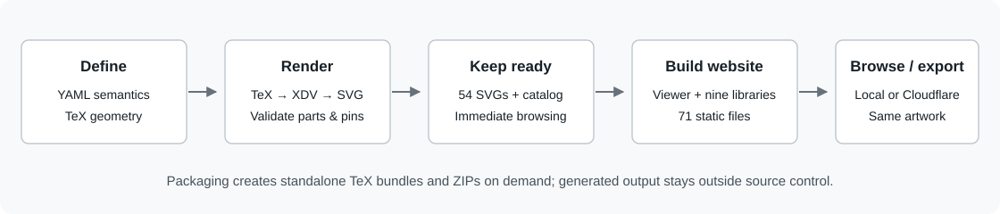

# Develop Schematica

[Preview](https://schematica-preview.dinodubroja.workers.dev/)
· [Inkscape](docs/INKSCAPE.md)
· [Scope and gaps](docs/ROADMAP.md)
· [Current status](context/CURRENT.md)

## Delivery checklist

Complete this checklist at meaningful checkpoints and before declaring work finished.

1. **Publish the branch.** Push each agent's branch at meaningful checkpoints and
   before finishing, within the task's publication authorization. Verify the remote
   commit. If publishing is blocked, report the reason and unpublished checkpoint.
2. **Keep setup and testing current.** User instructions must be visual with useful
   screenshots or extremely compact: **action → expected result**. Keep developer
   commands separate from user instructions; state actual results and unverified limits.
3. **Keep main discoverable.** GitHub's `main` README is the user's entry point:
   link setup, testing and available previews, and label unfinished features and
   limitations. Users must not need to navigate branches to discover progress.
4. **Coordinate integration.** Agent A integrates exact commits marked READY by
   their owners, resolves conflicts and checks the combined result before updating
   `main`, within authorized scope. Branch pushes, merges and website deployments
   are separate actions. Preserve checkout ownership and the current preview publisher.
5. **Verify the delivery.** Check published documentation links at their actual
   GitHub/preview destinations. Distinguish backend tests from actual installation,
   setup and first-use verification; record blocked or untested checks honestly.
6. **Report the result.** Finish with **what changed → GitHub/preview link → what to
   test → remaining limitations**. Explicitly state whether the branch, `main` and
   hosted app were updated; local commits alone are not a GitHub update.

Use existing authorization without repeated approval pauses. The checklist does
not grant permission for a new publication, product merge or deployment; explain
any missing authorization or external blocker. See [parallel work](#parallel-work)
for ownership and handoffs.

## Latest changes

Schematica Review adds private, persistent comments and exact-revision decisions,
History comparison, shared feedback, recoverable discard, and a desktop connector
using the existing ChatGPT subscription. Library keeps its presentation and exports;
verification controls move to Review. All 91 accepted designs and 1,035 drawings
remain unchanged. Agent A's exact ready host fixes are included; its experimental
symbols and runtime remain isolated.

[Review workflow](docs/REVIEW.md) · [Setup, API and recovery](docs/REVIEW_SETUP.md)
· [Delivery evidence and limits](context/CURRENT.md)

### Test on both Windows devices

| Action | Expected result |
|---|---|
| Open Library; search NPN; choose Small / Thick | Accepted drawing, working dark/light mode and exact SVG download |
| Open Variations; export the library while filtered | Comparison rows; complete library at the chosen settings |
| Open Review and sign in on both devices | Same candidates, saved feedback and progress |
| Save a comment on one device; reload on the other | The exact comment appears |
| Verify an older History revision | That revision is selected; Library is unchanged until processing |
| Discard and restore | Candidate is recoverable; published predecessor stays visible |
| Process with the desktop stopped, then start it | Waiting for desktop changes to Working; proposals require approval |
| Approve a correction | New revision returns unverified; old source and feedback remain in History |

The initial production queue is empty: accepted symbols are already published.
Use a real submitted candidate for the Review checks. Synthetic fixtures remain
on the separate validation site. Physical phone and second-device testing remain
user checks. Each delivery records the actual build and hosted verification in
[current status](context/CURRENT.md).

## Run on Windows

From the repository root, with Python **3.12 or newer**:

```powershell
python -m venv .venv
.\.venv\Scripts\python.exe -m pip install -r app\requirements.txt
.\app\launch.ps1
```

Open the printed address, normally **http://127.0.0.1:8765/**. Keep the terminal
open; Ctrl+C stops the server. To use another port, run
`.\app\launch.ps1 -Port 8792`. `-NoBrowser` leaves opening the browser to you.
If Windows blocks the chosen port, try another; 8792 passed on this desktop.
The launcher now reports server-start failures as errors. If PowerShell blocks
scripts, run the equivalent Python commands:

```powershell
.\.venv\Scripts\python.exe app\build_site.py
.\.venv\Scripts\python.exe app\server.py --open
```

Browsing and packaging existing artwork require only Python and PyYAML. No TeX,
Inkscape, Node.js or Cloudflare account is needed. Open the served address rather
than the HTML file itself. The launcher uses the root `.venv`, then an existing
workspace environment if available, then Python on PATH.

## Parallel work

`main` is the shared product baseline. Start future task branches/worktrees from
current main; keep separate working folders for parallel tasks, not separate
long-lived product versions. Agent A coordinates exact owner-ready commits and
checks the combined result. For this consolidation, Agent A completed publication,
superseding the earlier B-only restriction. Later deliveries name one publisher
within their task authorization; branch pushes and deployment remain separate.

Read the workspace's `Local/parallel-work` ownership records before shared changes.
Preserve active work, ignored drafts and runtime/configuration paths; do not switch
another agent's active checkout. Keep creation tests in an explicitly initialized
isolated library. Retire only fully merged inactive branches or recoverably
preserved obsolete worktrees. A retained runtime checkout must follow the same
consolidated baseline. Follow the [delivery checklist](#delivery-checklist).

## Get the project on another Windows device

For web testing, open the preview from the GitHub README; no local project is
required. For source work, keep a separate Git checkout on each device, outside
OneDrive. Install [Git for Windows](https://git-scm.com/install/windows) if needed.

First copy, from a local projects folder:

```powershell
git clone https://github.com/DinoDubroja/schematica.git
cd schematica
```

Then follow [Run on Windows](#run-on-windows). The existing laptop checkout was
already set up during the first batch; update that copy instead of cloning again.

Use **`main`** for the complete current product. A fresh clone selects it by default.
For an existing checkout, inspect ownership and local/concurrent work before updating.
If it is clean and inactive, run `git fetch origin`, `git switch main`, then
`git merge --ff-only origin/main`. Preserve work and stop on conflicts or divergence;
do not discard local changes or switch another agent's active task checkout.

Before updating an existing copy, run `git status --short`. If it lists files,
preserve and resolve that work first. If empty, run `git pull --ff-only`. Stop on
divergence; do not overwrite the other device's work. Commit/push reviewed work
within the current publication authorization before switching devices, and pull
before starting on the receiving device. Use `app\launch.ps1`; the old `implementation\launch.ps1` path is gone.
If the existing preview server holds the old folder open, stop it with Ctrl+C
before pulling, then start it from the new path.
GitHub synchronizes source and docs; Cloudflare is a separate website deployment.
Downloaded SVGs and Inkscape drawings remain local unless separately synchronized.

## Find and edit

```text
schematica/
├── README.md               # Product overview and screenshot
├── DEVELOPMENT.md          # Setup, editing, checks and packaging
├── AGENTS.md               # Instructions for new Schematica
├── app/
│   ├── definitions/        # Names, descriptions, keywords, pins and parts
│   ├── presets.yaml        # Three sizes and three stroke weights
│   ├── tex/                # Authoritative parameterized geometry
│   ├── core.py             # Find, inspect and render; shared TeX export
│   ├── exports.py          # SVG, ZIP, sheet and Symbols composition
│   ├── library/            # Catalog and 1035 SVGs for immediate browsing
│   ├── verification.py     # Validate and apply chat approval handoffs
│   ├── verification.json   # Official acceptance, tied to actual geometry
│   ├── viewer/             # Accepted HTML/CSS/JavaScript interface
│   ├── build_site.py       # Portable website builder
│   ├── build_library.py    # Render candidates before promotion
│   ├── package.py          # Generate distributable ZIPs
│   ├── launch.ps1          # Windows entry point
│   ├── server.py           # Local static server
│   └── wrangler.jsonc      # Cloudflare static-asset settings
├── tests/                  # Automated checks, render checks and fixtures
├── docs/                   # Inkscape, roadmap and documentation images
└── context/                # Current status and new-project decisions
```

| Edit | Source | Then |
|---|---|---|
| Layout, controls, dark/light colors | [viewer/](app/viewer/) | Build website, tests, browser checklist |
| Description and search keywords | [definitions/](app/definitions/) | Build website; rebuild artwork to update SVG descriptions too |
| Symbol paths, leads or signs | [tex/](app/tex/) | Full rendering and Inkscape checks |
| Supported sizes/strokes | [presets.yaml](app/presets.yaml) and definitions | Requires an agreed scope change; regenerate and review |
| SVG composition and physical placement | [exports.py](app/exports.py) | Tests and Inkscape checks |
| Packaging and hosting output | [build_site.py](app/build_site.py), [package.py](app/package.py) | Build, package, validate downloads |



The viewer reads pre-rendered SVGs and a catalog. It never compiles TeX. The static
builder copies the accepted artwork, reads current editorial metadata and creates
36 complete-library exports. The website contains 1082 files, with no Python, source
TeX, references or test material. Its content hashes determine `build.json`.

## Test and review

Run from the repository root. Node.js **20 or newer** is needed only for the
browser-state tests; the app itself has no Node dependency.

```powershell
.\.venv\Scripts\python.exe -m unittest discover -s tests -v
node --test tests\review.test.cjs tests\configurations.test.cjs tests\host.test.cjs
.\.venv\Scripts\python.exe app\build_site.py
.\.venv\Scripts\python.exe tests\check_docs.py
```

Expect **77 Python tests and 11 JavaScript tests**, a **1082-file** website, and no
broken documentation links. Tests cover all designs/configurations, accepted SVG
bytes, pins, independent strokes, editable parts, exports, HTTP boundaries and
approval validity. Compare `app/dist/build.json` with the hosted `build.json` when
checking that both devices have the same version.

| Action | Expected result |
|---|---|
| Open the app; switch All symbols / Unverified | 91 designs, all Verified; Unverified is empty |
| Choose Resistors / Batch 01; search `NTC`, then `zzzz`, then clear | Two NTCs; empty state; the filtered batch returns |
| Select Variable resistor · US; open Variations | Stroke, Size and Arrow orientation rows; one setting varies per row, all others at defaults; no large preview |
| Choose Small / Thick / Down-left; open Variations | Comparison rows still use defaults, independently of the main preview selection |
| Try all orientations on variable/trimmer US/EU | Only the diagonal marking reflects; body, leads and blue pin identities stay fixed |
| Inspect potentiometers, NTC/PTC, photos and nonlinear resistors | Wiper tip centered 1 mm above body; labels readable; arrows symmetric; diagonal S has no arrowhead; no varistors |
| In an isolated test library, check an Unverified design; reload | Pending in this browser; selection and exact design identity persist |
| In that test library, Verify & next, then Undo | Selects the next unreviewed design; Undo reverses the pending selection |
| Copy approvals or Copy symbol reference | Approval JSON includes exact revision/fingerprint; reference includes name/ID/revision/link |
| Open the reference link in another browser | Same design selected; local approvals are not transferred |
| Switch dark/light; reload; use Small/Thick and Grid & pins | Theme persists; stroke changes keep pins fixed; preview aids toggle together |
| Export Small/Thick/Down-left variable resistor, then the library while filtered | Single matches the selected marking; library has all 91 designs and Down-left on its 8 adjustable designs |
| Select a coil; export the library | Orientation controls disappear; adjustable designs in the library use Up-right |
| Inspect exported artwork | Black vectors, no blue points/grid; NTC/PTC glyph outlines stay grouped as temperature-mark |
| Open the library in Inkscape Symbols | 91 thumbnails; placed artwork can be unlinked, edited, saved and reopened |
| Use Tab, Enter, Escape, arrow keys on the tabs, and `/`; narrow the window | Controls remain reachable; dialogs return focus; search focuses; page does not overflow |

Repeat on both Windows devices using the [shared preview](https://schematica-preview.dinodubroja.workers.dev/).
Record device/browser, build ID, design reference, selected preset, failed action
and actual result. See [Inkscape](docs/INKSCAPE.md) for export/grid details and
[verification](docs/VERIFICATION.md) for approval handoff and clipboard fallback.

## Render and verify geometry

Only geometry work needs Tectonic, dvisvgm, Inkscape and the developer requirements.
The full-library CLI check uses two isolated Inkscape workers by default;
`--workers 1` runs serially. Only a Windows `Gio::DBus::Error` startup failure is
retried (up to three attempts); drawing/validation errors still stop the check.
Build candidates separately from the browsable library:

```powershell
.\.venv\Scripts\python.exe -m pip install -r app\requirements-dev.txt
.\.venv\Scripts\python.exe app\build_library.py --output app\build\candidates\current
$env:SCHEMATICA_LIBRARY = (Resolve-Path app\build\candidates\current).Path
.\.venv\Scripts\python.exe -m unittest discover -s tests -v
.\.venv\Scripts\python.exe tests\verify_library.py
.\.venv\Scripts\python.exe app\build_site.py
.\.venv\Scripts\python.exe tests\verify_site.py
.\.venv\Scripts\python.exe tests\verify_renderer.py
.\.venv\Scripts\python.exe app\server.py --port 8792
```

Inspect the candidate viewer at **http://127.0.0.1:8792/** and follow the
[creation workflow](docs/RESISTOR_BATCH.md#repeatable-creation-workflow). The renderer
excludes a design if any configuration fails and reports it in
`app/build/library-measurements.json`. Fix and repeat before promotion. Do not edit
generated SVGs as the drawing authority.

After technical and visual checks pass, stop that test server and promote only the
checked candidate output. Preserve concurrent edits before copying. Compare the
catalog file list with `app/library/svg/`; remove only backed-up obsolete SVGs
inside that folder (for example, removed designs or superseded optionless keys):

```powershell
# Back up the existing library first. Check the candidate and current status.
Copy-Item "$env:SCHEMATICA_LIBRARY\svg\*.svg" app\library\svg\
Copy-Item "$env:SCHEMATICA_LIBRARY\catalog.json" app\library\catalog.json
Remove-Item Env:SCHEMATICA_LIBRARY
.\.venv\Scripts\python.exe app\build_site.py
.\.venv\Scripts\python.exe -m unittest discover -s tests -v
```

NTC/PTC rendering retrieves Latin Modern Sans from the same cached Tectonic bundle
and gives dvisvgm a local font file; exported SVGs contain glyph outlines. Native
TeX uses the explicit font file with Tectonic/XeTeX. First use can require network
access to the TeX bundle; no font installation is required for browsing.

Set `SCHEMATICA_TECTONIC`, `SCHEMATICA_DVISVGM` and `SCHEMATICA_INKSCAPE` to executable
paths if discovery fails. On Windows use `inkscape.com`. The optional
`--symbols <ids...>` builds selected candidates for diagnosis; it does not merge
partial catalogs into the supplied library.

`verify_library.py` checks every SVG in Inkscape, 42 comparisons against the six
accepted palette designs, margins, named parts and composite save/reopen.
`verify_renderer.py` checks fresh compilation, native CircuitikZ and a bounded
editable-label fixture. `verify_site.py` checks all 36 complete-library exports;
add `--downloads <folder>` to compare actual browser downloads (36 libraries,
`inductor-coil-small-thick.svg`, and any other supplied single-symbol SVGs). Results go into ignored `app/build/` folders.
Command-line checks do not imply a GUI check.

The accepted palette is an independent regression reference, not an inherited
legacy style. Update it only after explicit geometry acceptance. Baseline tools:
Python 3.13.5, PyYAML 6.0.3, PyMuPDF 1.27.1, Tectonic 0.17.0+20260731,
dvisvgm 3.6, Inkscape 1.3.2. Tectonic may download its bundle on first use;
fresh-machine/offline rendering remains unverified.

## Package exports

```powershell
.\.venv\Scripts\python.exe app\package.py
```

Creates `app/build/exports/` with a hash manifest and three ZIPs:

| Package | Contents |
|---|---|
| `web-preview.zip` | 1082 static website files, ready for Cloudflare upload |
| `all-symbols.zip` | 1035 individual SVGs |
| `tex-bundles.zip` | 1035 standalone configurations, each with `symbol.tex` and required helpers |

Only the shared TeX recipes/helpers and prebuilt browser SVGs are maintained.
Generated standalone bundles and ZIPs are not committed. To use the native TeX
example, copy [native-circuitikz.tex](tests/fixtures/native-circuitikz.tex) beside
the helpers from [app/tex/](app/tex/), then compile it without the SVG driver.

## Core interface

```powershell
.\.venv\Scripts\python.exe app\core.py find coil
.\.venv\Scripts\python.exe app\core.py inspect opamp --size small --stroke thick
.\.venv\Scripts\python.exe app\core.py render capacitor --output app\build\capacitor
.\.venv\Scripts\python.exe app\core.py render resistor-variable-us --size small --stroke thick --option orientation=down-left
```

Python integrations use `find_symbols`, `get_definition`, `resolve_settings`,
`inspect_symbol`, `render_symbol` and `write_tex_bundle`. Inspection recompiles;
browsing uses the catalog. Stable IDs and revisions live in YAML; the [batch inventory](docs/RESISTOR_BATCH.md)
lists the resistor IDs. Configuration keys append size/stroke and declared options
(for example `resistor-variable-us-small-thick-orientation-down-left`). Unsupported
option values are rejected. `exports.export(kind, keys, columns=3, spacing=6)` supports `svg`,
`zip`, `sheet`, `symbols`; the viewer exposes the two agreed export actions.

## Hosting and documentation previews

The shared preview is a separate static deployment; Git pushes do not deploy it.
Prefer [Wrangler](https://developers.cloudflare.com/workers/wrangler/commands/general/)
for authorized publications. Build once, deploy, then compare the hosted `build.json`,
catalog and downloads against the local build. Routine publishing needs no automated
browser session or repeated Inkscape export checks.

From the canonical checkout on this workstation, the portable Wrangler 4.162.0
installation is outside the repository. Other worktrees must use its resolved
absolute path, not assume the same relative depth:

```powershell
.\.venv\Scripts\python.exe app\build_site.py
node ..\Local\tools\cloudflare\wrangler\node_modules\wrangler\bin\wrangler.js deploy --config app\wrangler.jsonc
```

On another publishing workstation, install Node.js 22.12 or newer with npm, then:

```powershell
npx wrangler@4.162.0 login --use-keyring --scopes account:read user:read workers:write workers_scripts:write
npx wrangler@4.162.0 deploy --config app\wrangler.jsonc
```

Login opens Cloudflare for the user to authorize. Credentials stay in Wrangler's
encrypted store with its key in Windows Credential Manager; do not put tokens in
chat or Git. The laptop needs no Cloudflare login merely to browse or run locally.
The [configuration](app/wrangler.jsonc) targets the existing `schematica-preview`
Worker; keep its name and preview URL. Record the deployed version and build ID.

To render these Markdown guides locally, install the developer requirements and run:

```powershell
.\.venv\Scripts\python.exe tests\check_docs.py --render
python -m http.server 8790 --bind 127.0.0.1 --directory app\build\docs
```

Open **http://127.0.0.1:8790/README.html**. Check images, tables, commands and links
at desktop and narrow widths. HTML previews are generated output, not another
documentation source.
