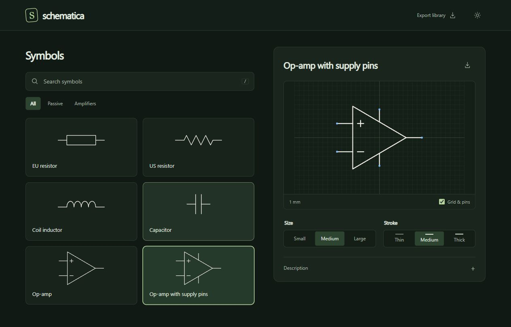

# Schematica

A symbol library for clear electronics drawings. Browse six appearances, choose
size and stroke independently, and export SVGs for Inkscape.

[Open the preview](https://schematica-preview.dinodubroja.workers.dev/)
· [Develop and test](DEVELOPMENT.md)
· [Use with Inkscape](docs/INKSCAPE.md)
· [Roadmap and scope](docs/ROADMAP.md)

The current app is a read-only browser with dark/light mode, individual SVG export
and six-symbol library export. Agent connections, customization and schematic
editing are future work.
