# Schematica

Beautiful, useful electronics illustrations with LaTeX: schematics, conceptual diagrams, waveforms, and equations composed together.

Schematica is in development. We are building a library of examples and drawing guidance to help AI agents produce consistent results from the first prompt.

## Explore the examples

### [General schematic preferences](preferences/README.md)

Accepted conventions with visual examples and before/after comparisons, shared across drawing styles.

### [The Art of Electronics](examples/THE_ART_OF_ELECTRONICS/)

Five recreated figures, from abstract connections to circuits with signal diagrams. Each includes an image, editable LaTeX, and the original caption.

[Browse the gallery →](examples/THE_ART_OF_ELECTRONICS/)

---

[Project direction](DIRECTION.md) · [Development checkpoint](context/CURRENT.md)
