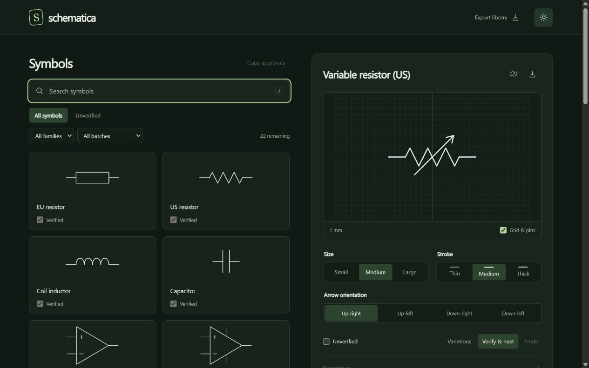

# Schematica

Browse **91 verified electronics symbols**, compare their **1,035 configurations**,
and download SVGs for Inkscape.

[Open Schematica](https://schematica-preview.dinodubroja.workers.dev/)
· [Windows setup](DEVELOPMENT.md#run-on-windows)
· [Quick checks](DEVELOPMENT.md#test-on-both-windows-devices)
· [Agent setup](docs/AGENT_INTEGRATION.md)
· [Current status](context/CURRENT.md)

The website supports browsing, search, configuration comparison, dark/light mode
and individual or complete-library SVG downloads. Local MCP integration adds a
shared selection viewer and confirmed creation/refinement in a separate dev store.
Actual ChatGPT/Claude embedded journeys and remote MCP connectivity remain
unverified. Website deployment alone does not enable an agent backend.

The consolidation is being verified before publication. `main` will be the shared
baseline; users will not need to choose between A/B product branches.

[Inkscape](docs/INKSCAPE.md) · [Symbol verification](docs/VERIFICATION.md)
· [Roadmap and limits](docs/ROADMAP.md) · [Delivery workflow](DEVELOPMENT.md#delivery-checklist)
