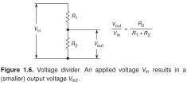

# Schematica

Beautiful, useful electronics illustrations with LaTeX: schematics, conceptual diagrams, waveforms, and equations composed together.

Schematica is in development. We are building a library of examples and drawing guidance to help AI agents produce consistent results from the first prompt.

## Preferences

[Browse all preferences](preferences/README.md).

<!-- preference-gallery:start level=3 -->

### [Connections](preferences/connections/README.md)

### [Symbols](preferences/symbols/README.md)

<!-- preference-gallery:end -->

## Explore the styles

### [The Art of Electronics](styles/THE_ART_OF_ELECTRONICS/)

Schematic and qualitative plot guidance, supported by examples. Five recreated figures include images, editable LaTeX, and the original captions.

[Showcase →](styles/THE_ART_OF_ELECTRONICS/) · [All examples →](styles/THE_ART_OF_ELECTRONICS/examples/README.md)

---

[Project direction](DIRECTION.md) · [Development checkpoint](context/CURRENT.md)
