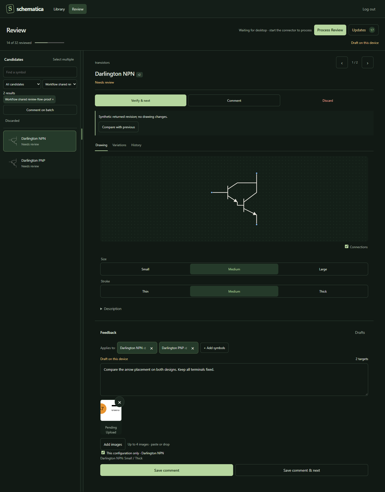

# Review

[Open Review](https://schematica-preview.dinodubroja.workers.dev/review)
· [Library](https://schematica-preview.dinodubroja.workers.dev/)
· [Desktop and developer setup](REVIEW_SETUP.md)

Review is the private workspace for filling the library. Saved feedback and decisions
are shared across your devices. The processing desktop needs to be running only when
applying corrections or publishing verified drawings.

[Phone drawing](images/review-phone.png) · [Phone feedback](images/review-phone-feedback.png)
· [Processing summary](images/review-processing.png). These screenshots show isolated
test fixtures, not additions to the public library.

## Browse and review

| Action | Expected result |
|---|---|
| Search Candidates by name or alias | Results update as you type; small typos are tolerated |
| Filter or select multiple candidates | Selection remains across filters; hidden selected items are accessible above the list |
| Drag the divider, or focus it and use arrow keys | Candidates width changes and is remembered; Home/End select its limits |
| Previous / Next | Moves within the current matching results |
| Verify & next | Saves the exact revision, then advances within the filtered queue without skipping; nothing publishes yet |
| History / Compare with previous | Shows actual dated events and drawings at the same viewing scale |
| Discard → Undo, or Discarded → Restore | Recovers the candidate; its published predecessor stays available |

On a phone, open **Candidates** for search and selection. The bottom review bar stays
out of the editor's way. **Description** remembers whether you left it open.

## Comment on one or several symbols

The editor below the preview lists **Applies to** targets, each with its exact revision.
Use **+ Add symbols**, an explicit **Also apply to…** suggestion, or **Comment on selected**.
Verified symbols remain available. Remove a target with × before saving.

**This configuration only** applies to the named symbol's current settings. Added
symbols default to all configurations; settings are never copied across incompatible
symbols. Target names and any narrower scope stay visible before and after saving.

Use **Add images**, phone **Take photo**, or desktop paste/drop. Up to four PNG, JPEG
or WebP images are supported, each up to 10 MB before resizing to 1600 pixels and 1 MB.
Tap a thumbnail to enlarge it. Convert HEIC/GIF first.

**Draft on this device** means unfinished feedback is stored in this browser.
Navigation, resizing, reload and failed uploads retain text, images and targets.
Use **Drafts** to reopen other unfinished comments. **Saved** means the full comment
reached the server and is available on your other devices.

Saved feedback shows each target's result: **Queued / Working / Updated / Needs your
answer / Failed**. **Apply this comment to another symbol…** adds a new exact target
without repeating completed work on existing targets. Earlier text, targets and images
remain in comment history. **Retry failed** selects only the failed work for confirmation.

## Start processing

**Process Review → inspect summary → Confirm & process**

Opening the summary starts nothing. It shows saved comments and images per symbol,
plus a separate **Ready to publish** group of explicitly verified revisions. Exclude
items for this run without deleting feedback. Save unfinished feedback and refresh,
or explicitly keep drafts for later. **Return to Review** starts nothing.

Only the included snapshot is authorized by **Confirm & process**. If relevant saved
work changes first, the summary refreshes and needs confirmation again. Retrying an
uncertain request does not create duplicate jobs.

The desktop applies corrections directly. An essential ambiguity can produce a question
in **Updates**, while independent symbols continue. The badge counts returned drawings
still needing review. Arrivals preserve the current drawing, editor and scroll position.
Corrected drawings are **Unverified**; the previous published version stays in Library
until you explicitly verify and confirm publication of its replacement.

## Quick check on both devices

1. Search and filter Candidates → select a few → change the filter; selection stays visible.
2. Write feedback, add another target and an image → resize or reload; the draft stays intact.
3. Save → open Review on the other device; names, scopes and the enlarged image match.
4. Open Process Review → inspect/exclude items → return; no work starts before final confirmation.
5. When ready, confirm your intended work → inspect each result in Updates; new drawings still need your verification.

Desktop and phone-sized browser views are tested. A physical phone, its keyboard/camera,
and your second Windows device still need your hands-on check. Unsaved drafts stay on
their original browser. Ordinary Library and its exports remain separate from private Review.
