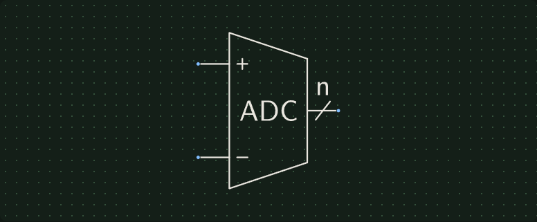
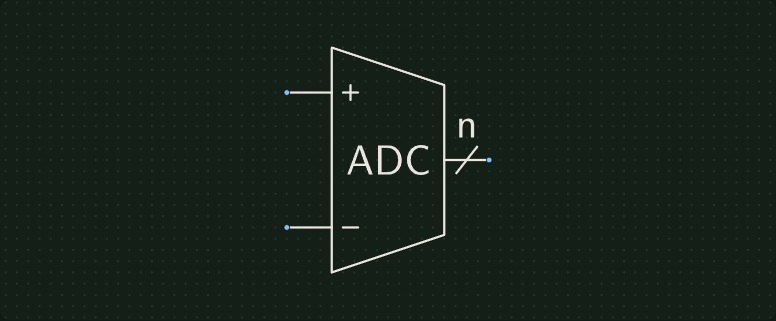

# Review grid alignment

[Open Review](https://schematica-preview.dinodubroja.workers.dev/review)

Review now draws its **1 mm grid inside the symbol SVG**. The old background repeated
every 16 CSS pixels independently of the fitted drawing. Grid dots, blue terminals
and artwork now share one origin and scale, including during resizing and browser zoom.
Library and Review share the [coordinate conversion](../app/viewer/preview-coordinates.js).

Before, from the actual hosted Review:



After, from Review with the corrected coordinates:



## Quick check on either device

| Action | Expected result |
|---|---|
| Refresh Review; open the differential ADC | All three blue terminals meet lead ends and grid dots. |
| Change Size and Stroke; try a transistor or multi-terminal block | Connections stay on the grid; stroke does not move them. |
| Resize the window; try 80%, 125% and 200% browser zoom | Grid and drawing resize together. |
| Toggle Connections off and on | Only the blue markers hide; the grid and artwork stay put. |
| Open History or ordinary Library | Saved drawings and decisions remain available. |

## Verification and limits

- Actual Review tested with 108 configurations across seven designs: resistor,
  variable resistor (all orientations), PNP, differential ADC, 4:1 multiplexer,
  DPDT relay and tunable band-pass (all widths).
- 324 configuration/viewport checks at desktop, tablet and phone widths, plus
  continuous resizing without recreating the SVG and 24 real Chrome zoom checks.
- Terminal centres were compared with endpoints read from the saved SVG paths.
  Maximum measured error was below 0.002 CSS pixels; no source-geometry defects
  were found in the tested configurations. These samples do not certify every design.
- Regression coverage includes an asymmetrically cropped SVG, shared origin/scale,
  marker placement and independent Connections visibility.
- 87 Python tests, 30 JavaScript tests and 138 documentation links passed.
  Library's actual preview also passed with the shared coordinate module.
- At 200% zoom on a 390-pixel-wide window, the resulting 195 CSS pixel viewport
  overflows the existing header. This occurs before and after the fix; alignment
  remains correct. Physical-device testing is still a user check.

No symbol artwork, metadata, saved revision, comment, decision or approval is changed
by this fix. Browser checks use read-only service access and do not publish candidates.

## Developer checks

```powershell
node --test tests/preview-coordinates.test.cjs
python -m unittest discover -s tests -v
node --test tests/*.test.cjs tests/*.test.mjs
python tests/check_docs.py
```

With Chrome, Playwright and the existing private Review connection configured:

```powershell
node tests/review-grid-browser.cjs --config <private-config.json> --output output/playwright/review-grid/hosted
```

Use `--local` to check edited UI assets against live read-only data before deployment.
The test uses a disposable browser profile for zoom settings; it does not alter your
normal browser. The result receipt records each configuration, endpoint error and
zoom level. Credentials and full private receipts remain outside Git.
