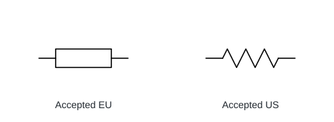
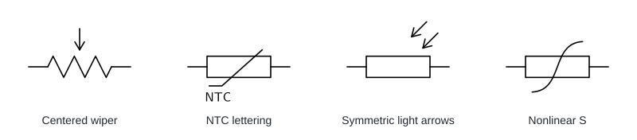

# Symbol construction reference

Established 13-11-2026, before the resistor corrections. Reuse this reference set
for later batches; revise it when a source or an accepted design decision changes.

## Sources and limits

| Reference | What was reviewed | Use |
|---|---|---|
| [CircuitikZ 1.8.7, 12-09-2026](https://rmano.github.io/circuitikz/node-The-components-list.html), §4.2–4.2.3 | Component definitions, wiper anchors, modifier/arrow customization | Preferred starting geometry: `R`, `vR`, `pR`, `thR`, `thRn`, `thRp`, `phR`, `ldR`; custom TeX where needed |
| [IEC 60617:2026 DB](https://webstore.iec.ch/en/publication/2723) | Official scope and database description | Electrical-symbol meanings belong here. Individual symbol records require access; database and snapshot requests returned 403. No exact IEC record or dimensional compliance is claimed |
| [ISO 81714-1:2010, edition 2](https://www.iso.org/standard/42100.html) | Official scope, edition and public contents | Construction reference: grid/module, line width, spacing, connect nodes, terminal lines, text and variants. Detailed clauses were inaccessible; no numeric rule below is attributed to them |
| [Accepted Schematica palette](../tests/fixtures/accepted-palette/) | Existing six designs and independent regression fixture | Appearance, physical scale, connections and strokes remain the baseline |

**Standard-derived boundary:** IEC supplies standardized meanings; ISO addresses
symbol construction. The accessible material establishes those roles, not a
compliance assessment. CircuitikZ is a drawing implementation, not proof of IEC
compliance. US/EU names describe appearance. The diagonal S marking is the user's
confirmed custom nonlinear-resistor form; it is not assigned an unreviewed IEC ID.

## Appearance baseline

All dimensions below are **Schematica choices**, based on the accepted palette or
the user's correction. Let `f` be 0.75, 1 or 1.25 and `s = 5f/3 mm`, the recipe's
coordinate unit. A gap is measured between construction centre-lines unless stated.

| Feature | Measurable rule |
|---|---|
| Body proportions | Width `6s` = 7.5 / 10 / 12.5 mm; height `2s`. Keep the existing rectangle and zigzag paths |
| Stroke | 0.15 / 0.20 / 0.30 mm, independent of size; rounded caps and joins |
| Terminals | A/B at x = −7/+7, −8/+8, −10/+10 mm, y = 0. Pin identities never follow a reflected marking |
| Potentiometer | Wiper terminal x = 0, y = 5 / 6 / 8 mm. Vertical lead; arrow tip x = 0, y = upper body edge + **1 mm**, including trimmers |
| Open arrowheads | Symmetric wings about shaft axis: axial length `0.75s`, half-width `0.45s`. Use one construction for adjustment and light arrows |
| Light arrows | Parallel 45° shafts, length `2s`, perpendicular separation `1.5s`; identical heads. Place the pair clear of the body/enclosure |
| Adjustment orientation | Up-right default; reflect only the marking to obtain up-left, down-right, down-left. No body/pin reflection |
| Variable arrow clearance | Shaft runs from `(−2s, −2s)` to `(2.4s, 2.4s)` before reflection. The head clears the EU body by at least 0.38 mm of visible space in Small/Thick |
| NTC / PTC labels | Latin Modern Sans, identical cap height `0.84s` (1.4 mm at medium), common left edge and baseline, clear of the dependency mark; vector glyphs in SVG |
| Nonlinear marking | Selected B: one cubic, no centre join, arrowhead or voltage label. Axial half-length `5.6f` mm; lateral control offsets `±3.4f` mm at axial coordinates `∓5.6f/3` mm; rotated 45° across the body |
| Clearance and crop | At least 0.9 mm measured page margin. Keep unrelated marks separated by at least one thick stroke (0.30 mm) of visible space in Small/Thick; check letter counters and intended crossings visually |

NTC identifies a negative temperature coefficient; PTC identifies a positive one.
The unqualified thermistor remains unqualified. Potentiometers have three electrical
terminals; diagonal adjustment marks on two-terminal resistors add no terminal.

## Current constructions

All shown designs are user-approved, including nonlinear revision 3 with selected
option B. These images use the actual current exports.

The renderer retrieves the TeX bundle's font for dvisvgm and exports outlines,
following [dvisvgm's font guidance](https://dvisvgm.de/FAQ/). This avoids dependence
on the viewer's installed fonts. Labels remain a named editable vector part.

## Apply to a batch

1. Map each finite inventory item to the references above and its electrical meaning.
2. Refine representatives before sharing constructions: US/EU potentiometer,
   Small/Thick NTC/PTC, both photoresistor forms, adjustment orientations and nonlinear S.
3. Compare related designs together at common scale and at normal drawing size.
   Check proportions, symmetry, gaps, typography and readability, not just compilation.
4. Render **every combination**. A four-orientation design has 36, even though
   Variations shows one option per row. Check bounds, pins, parts, exports and Inkscape.
5. Promote only passing designs as Unverified. Keep the user's approval separate.

See [batch inventory and workflow](RESISTOR_BATCH.md) and [verification](VERIFICATION.md).
