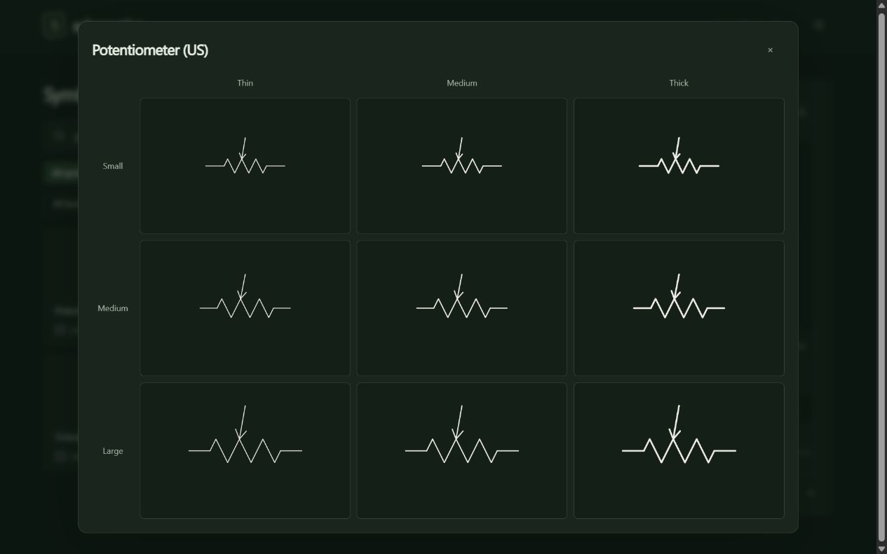

# Review and verify symbols

**Verified** is the published record. **Pending** is your selection in this browser.
Every new design starts **Unverified**, even after passing technical checks.
One approval covers all nine size/stroke configurations.



## In the viewer

1. Open **Unverified** and optionally choose a family or batch.
2. Select a design. Use **3 × 3** to compare all sizes and strokes at the same scale.
3. Check its box or choose **Verify & next**. **Undo** reverses a pending selection.
4. Choose **Copy approvals** and paste the result into chat. If copying is blocked,
   a text box opens: select all and copy manually.
5. Ask the agent to apply and publish those approvals. Reload the preview after
   publication: the designs become **Verified** for everyone.

Selections survive reload in the same browser. They do not sync between devices
or browsers and may be lost when browser data is cleared. If storage is blocked,
copy before closing the page. Clicking a checkbox never updates the supplied library.

For a correction, use the link icon beside the symbol name: **Copy symbol reference**
copies its name, stable ID, revision and link. Describe the change in chat.

## Agent handoff

Save the pasted JSON to an ignored file such as `app/build/approvals.json`. Then,
from the repository root:

```powershell
.\.venv\Scripts\python.exe app\verification.py check app\build\approvals.json
.\.venv\Scripts\python.exe app\verification.py apply app\build\approvals.json
.\.venv\Scripts\python.exe app\build_site.py
.\.venv\Scripts\python.exe -m unittest discover -s tests -v
node --test tests\review.test.cjs
```

`check` changes nothing. `apply` validates the entire handoff before updating
[the official record](../app/verification.json). Unknown IDs, changed revisions,
changed drawings and duplicates reject the whole handoff. Applying the same valid
handoff twice makes no additional changes. Review the diff; commit/push/deploy only
within the user's authorization. Building locally does not update the hosted site.

The fingerprint covers all nine SVG drawings and their electrical connections.
Geometry, terminal mapping or revision changes make the old approval inapplicable.
Names, descriptions and keywords alone do not. Unchanged rebuilds preserve approval.
The builder refuses stale artwork when its drawing sources changed without rendering.
Old pending selections are discarded on reload and cannot be recovered through Undo.

After a requested drawing fix, increment its revision, regenerate and repeat the
[batch checks](RESISTOR_BATCH.md#repeatable-creation-workflow). Publish the changed
design as **Unverified**. Do not copy its old approval fingerprint to the new record.
Revoking an unchanged official approval also requires a chat-mediated update of
the official record and publication; the browser cannot revoke it. On an explicit
revocation request, remove only that design's entry from `approvals` in
`app/verification.json`, preserve all other entries, then rebuild, test and publish
within the authorization. Review the diff and confirm the design is Unverified.

## Check the handoff safely

Use a separate temporary copy of the app with a temporary official record. Never
apply test approvals in the real repository. The automated tests use temporary
files and isolated browser-storage objects.

| Action | Expected result |
|---|---|
| Select a design, reload | Checked, Pending; official catalog unchanged |
| Undo, including after reload | Previous pending selection restored; official status unchanged |
| Copy approvals with clipboard access blocked | Read-only text fallback contains the complete JSON |
| Apply valid temporary handoff, rebuild and reload | Official Verified; matching pending selection cleared |
| Apply unknown or stale handoff | Rejected; official file unchanged |
| Apply a valid handoff twice | Second application reports no changes |
| Change drawing or connection; rebuild | Old approval no longer verifies that design |
| Correct description or rebuild unchanged | Approval remains valid |
| Open another browser/device before publication | No local selections transferred; same official status |
