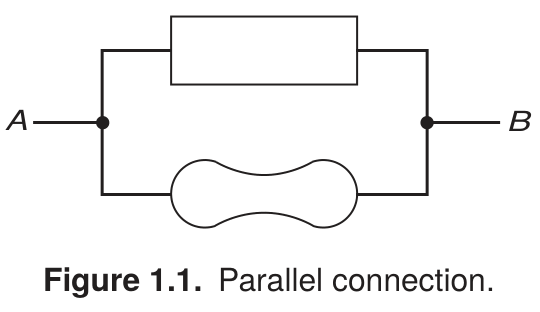
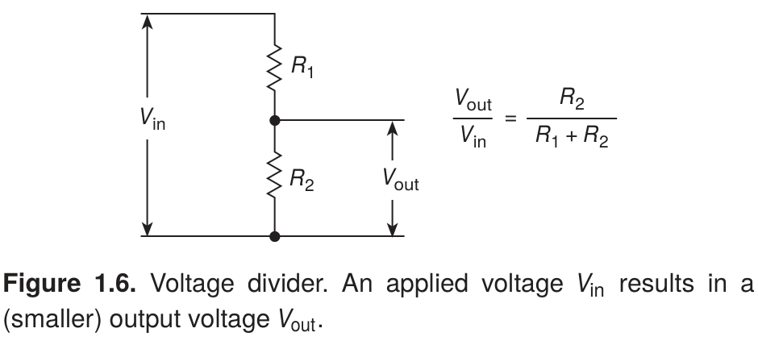
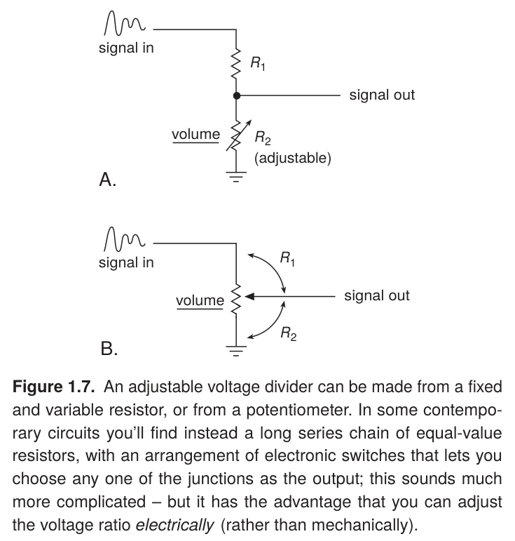
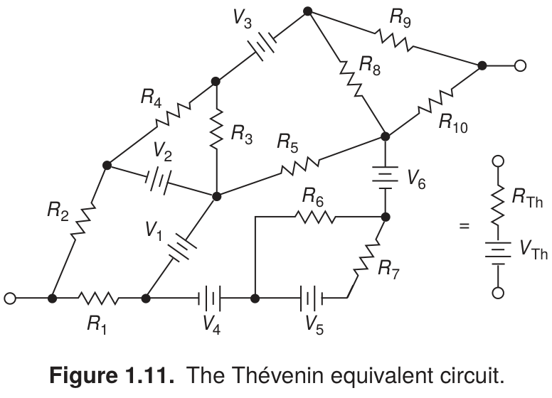
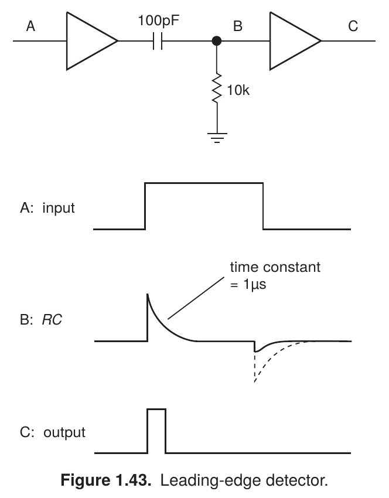

[← Schematica](../../)

# The Art of Electronics

A growing collection of electronics illustrations from Paul Horowitz and Winfield Hill's *The Art of Electronics*, third edition (2015).

Open a figure for its PNG, editable LaTeX, and original caption.

### [Parallel connection · Figure 1.1](fig-01-01-parallel-connection/)

Abstract shapes make the connection itself the subject.

---

### [Voltage divider · Figure 1.6](fig-01-06-voltage-divider/)

A circuit, voltage annotations, and an equation explain one relationship.

---

### [Adjustable voltage divider · Figure 1.7](fig-01-07-adjustable-divider/)

Small signal sketches and control annotations clarify two alternative circuits.

---

### [Thévenin equivalent circuit · Figure 1.11](fig-01-11-thevenin-equivalent/)

A complex network and its compact equivalent share one composition.

---

### [Leading-edge detector · Figure 1.43](fig-01-43-leading-edge-detector/)

Matching circuit labels and waveform panels connect structure to behavior.

---

[Style guide and collection notes](STYLE.md) · [← Schematica](../../)
