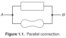

# Parallel connection

- **Origin:** reference; recreated in LaTeX.
- **Source:** Paul Horowitz and Winfield Hill, *The Art of Electronics*, third edition (2015), Figure 1.1, printed page 2 (PDF page 35).
- **User feedback:** liked specifically as an abstract diagram explaining parallel connection rather than a practical electronic circuit.
- **Recreation:** editable source and PNG completed on 08-11-2026 under the user's explicit request to finish the three missing examples. Compiled and visually checked against the book by the assistant; user review of this recreation is pending. The original reference feedback remains distinct from review of the recreation.

[Gallery page](README.md) · [Editable LaTeX source](drawing.tex)

SVG: [light](preview-light.svg) / [dark](preview-dark.svg) · [PNG download](preview.png)

## Original caption

> **Figure 1.1.** Parallel connection.

Caption transcribed from the supplied reference; source identified above.

## What it demonstrates

A rectangle and an arbitrary curved shape occupy two branches between the same terminals, labelled A and B. Their internal nature is unimportant to the connectivity being explained.

## User comments

The user identified this as a useful example for more abstract diagrams. This is explicit approval of its conceptual role, not a requirement to reuse these exact two shapes.

## Inferred lessons to review

- Generic shapes can explain topology without implying particular components.
- Clear shared terminals and junctions can carry the explanation with very little text.

## Use and limits

Select for abstract connectivity or topology explanations. Original screenshots remain working inputs rather than saved drawing outputs.

The source uses editable TikZ paths inside CircuitikZ to preserve the reference geometry. It is a visual recreation, not a native-component template. TeX Gyre Heros approximates the book's typography. Compile the standalone source with Tectonic or XeLaTeX with CircuitikZ and `tgheros` available. The PNG is rendered from that source, including the original caption; keep temporary build products outside the example folder.

Transparent light/dark SVG previews are derived from the same compiled source. SVG is the default for chat and GitHub; the original PNG remains available as a download. This presentation update does not change the drawing or its review status.
