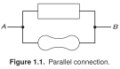

[Schematica](../../../) / [The Art of Electronics](../)

# Parallel connection

Two unspecified branches share the same terminals. The diagram explains connectivity without choosing particular components.

SVG: [light](preview-light.svg) / [dark](preview-dark.svg) · [PNG](preview.png) · [LaTeX source](drawing.tex) · [Example notes](EXAMPLE.md)

Original caption and source

> **Figure 1.1.** Parallel connection.

Paul Horowitz and Winfield Hill, *The Art of Electronics*, third edition (2015), Figure 1.1, p. 2. The image above is a LaTeX recreation; its caption is retained from the book.

---

[← Gallery](../) · [Next: Voltage divider →](../fig-01-06-voltage-divider/)
