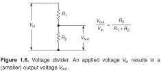

# Voltage divider

- **Origin:** reference; recreated in LaTeX.
- **Source:** Paul Horowitz and Winfield Hill, *The Art of Electronics*, third edition (2015), Figure 1.6, printed page 7 (PDF page 40).
- **User feedback:** liked overall; no feature-specific comment accompanied this reference.
- **Recreation:** editable source and PNG completed on 08-11-2026 under the user's explicit request to finish the three missing examples. Compiled and visually checked against the book by the assistant; user review of this recreation is pending. The original reference feedback remains distinct from review of the recreation.

[Gallery page](README.md) · [Editable LaTeX source](drawing.tex)

SVG: [light](preview-light.svg) / [dark](preview-dark.svg) · [PNG download](preview.png)

## Original caption

> **Figure 1.6.** Voltage divider. An applied voltage $V_{\mathrm{in}}$ results in a (smaller) output voltage $V_{\mathrm{out}}$.

Caption transcribed from the supplied reference; mathematical subscripts are preserved as Markdown math.

## What it demonstrates

Two vertically arranged resistors form a divider. Input and output voltage spans are indicated beside the circuit, and the divider equation appears alongside it. The drawing integrates the circuit, the quantities being compared, and the relationship between them.

## Inferred lessons to review

- Place a compact governing equation beside the circuit when the two explain each other.
- Voltage-span annotations can communicate a relationship without adding a full measurement instrument or an unnecessary signal source.
- Keep related labels close to the illustrated spans with clear space around them.

## Use and limits

Select for a circuit-and-equation composition or voltage annotations. Overall approval does not establish every notation or arrow choice as a universal convention. The voltage-divider relationship must be used with its applicable loading assumptions in new work.

The source uses editable TikZ paths inside CircuitikZ to preserve the reference geometry, with individually positioned text for the labels and equation. It is a visual recreation, not a semantic component template or a parameterized equation layout. TeX Gyre Heros approximates the book's typography. Compile with Tectonic or XeLaTeX with CircuitikZ and `tgheros` available. The PNG is rendered from that source, including the original caption; keep temporary build products outside the example folder.

Transparent light/dark SVG previews are derived from the same compiled source. SVG is the default for chat and GitHub; the original PNG remains available as a download. This presentation update does not change the drawing or its review status.
