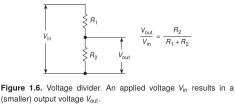

[Schematica](../../../) / [The Art of Electronics](../)

# Voltage divider

Voltage spans and the nearby equation explain the circuit together, with very little annotation.

SVG: [light](preview-light.svg) / [dark](preview-dark.svg) · [PNG](preview.png) · [LaTeX source](drawing.tex) · [Example notes](EXAMPLE.md)

Original caption and source

> **Figure 1.6.** Voltage divider. An applied voltage $V_{\mathrm{in}}$ results in a (smaller) output voltage $V_{\mathrm{out}}$.

Paul Horowitz and Winfield Hill, *The Art of Electronics*, third edition (2015), Figure 1.6, p. 7. The image above is a LaTeX recreation; its caption is retained from the book.

---

[← Gallery](../) · [Previous: Parallel connection](../fig-01-01-parallel-connection/) · [Next: Adjustable voltage divider →](../fig-01-07-adjustable-divider/)
