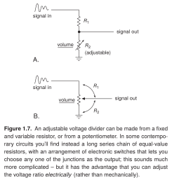

# Adjustable voltage divider

- **Origin:** reference; recreated in LaTeX.
- **Source:** Paul Horowitz and Winfield Hill, *The Art of Electronics*, third edition (2015), Figure 1.7, printed page 7 (PDF page 40).
- **User feedback:** liked overall; the small input signal sketches were specifically praised as useful schematic annotations.
- **Recreation:** source and rendered preview available. The user gave positive feedback on the recreation's appearance. This does not approve all implementation details as reusable style rules.

[Gallery page](README.md) · [Editable LaTeX source](drawing.tex)

SVG: [light](preview-light.svg) / [dark](preview-dark.svg) · [PNG download](preview.png)

## Original caption

> **Figure 1.7.** An adjustable voltage divider can be made from a fixed and variable resistor, or from a potentiometer. In some contemporary circuits you'll find instead a long series chain of equal-value resistors, with an arrangement of electronic switches that lets you choose any one of the junctions as the output; this sounds much more complicated – but it has the advantage that you can adjust the voltage ratio *electrically* (rather than mechanically).

Caption transcribed from the supplied reference; line wrapping and ligatures are normalized. It is also present in the existing recreated figure.

## What it demonstrates

Panel A uses a fixed resistor and an adjustable resistor. Panel B uses a potentiometer. Small signal sketches sit near the input terminals. Underlined volume labels identify the controls, and curved annotations identify the two portions of the potentiometer.

## User comments

The user specifically wanted small squiggly signal representations near inputs to be supported by Schematica from the start. This reference also supports comparing alternative implementations in one figure.

## Inferred lessons to review

- A small waveform beside a terminal can convey signal character without a separate plot panel.
- Related panels can share typography and annotation conventions while expressing different physical arrangements.
- Curved annotations can identify portions of a component when ordinary labels would be ambiguous.

## Use and implementation limits

Select for adjustable elements, small signal annotations, or paired circuit alternatives. The source uses editable TikZ paths inside a `circuitikz` environment, including traced symbol geometry. It is a visual reference implementation, not yet a component-based reusable circuit template.

The font is TeX Gyre Heros, a portable approximation to the reference typography. Compile the standalone source with Tectonic or XeLaTeX with CircuitikZ and `tgheros` available. Keep temporary build products outside the example folder. The saved source and preview are preserved from the reviewed recreation.

Transparent light/dark SVG previews are derived from the same compiled source. SVG is the default for chat and GitHub; the original PNG remains available as a download. This presentation update does not change the drawing or its review status.
