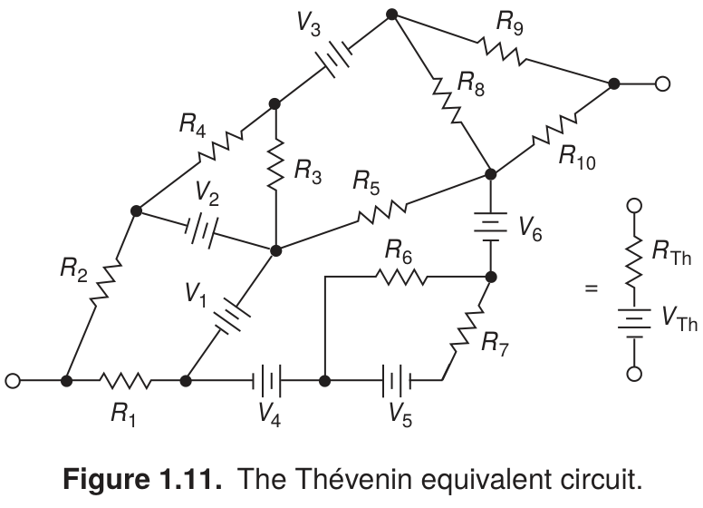

# Thévenin equivalent circuit

- **Origin:** reference; recreated in LaTeX.
- **Source:** Paul Horowitz and Winfield Hill, *The Art of Electronics*, third edition (2015), Figure 1.11, printed page 9 (PDF page 42).
- **User feedback:** specifically liked as a circuit illustrating a concept rather than a practical circuit.
- **Recreation:** editable source and PNG completed on 08-11-2026 under the user's explicit request to finish the three missing examples. Compiled and visually checked against the book by the assistant; user review of this recreation is pending. The original reference feedback remains distinct from review of the recreation.

[Gallery page](README.md) · [Editable LaTeX source](drawing.tex)

## Original caption

> **Figure 1.11.** The Thévenin equivalent circuit.

Caption transcribed from the supplied reference, including the accented name.

## What it demonstrates

A large irregular network of resistors and voltage sources is shown beside its compact two-terminal equivalent. Angled branches and exposed terminals make the network's structure and the equivalence visible.

## User comments

The user emphasized the value of circuits that illustrate a concept. The example is useful even though it does not represent a practical implementation to build.

## Inferred lessons to review

- Conceptual networks need not be forced into the routing of a practical schematic.
- A complex network and a small equivalent can be compared directly within one composition.
- Preserve the identity of the external terminals so the equivalence is understandable.

## Use and limits

Select for network equivalence, simplification, or abstract circuit topology. The angled layout is appropriate to this explanation, not a default for every schematic.

The source uses editable TikZ paths inside CircuitikZ to preserve the reference topology and geometry. It is a visual recreation, not a semantic component template or an electrical simulation. Wires meet hollow terminal boundaries without filling their interiors. TeX Gyre Heros approximates the book's typography. Compile with Tectonic or XeLaTeX with CircuitikZ and `tgheros` available. The PNG is rendered from that source, including the original caption; keep temporary build products outside the example folder.
