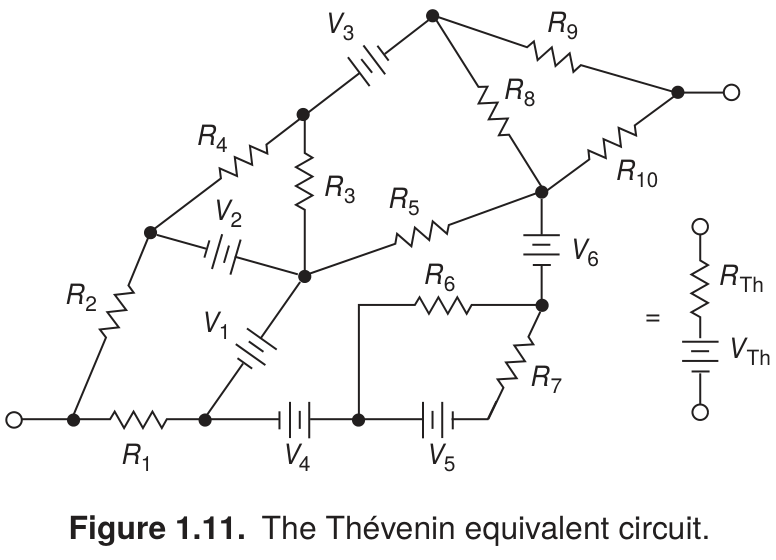

[Schematica](../../../) / [The Art of Electronics](../)

# Thévenin equivalent circuit

Angled branches expose the network topology, while a small equivalent circuit makes the central idea easy to compare.

[Open PNG](preview.png) · [LaTeX source](drawing.tex) · [Example notes](EXAMPLE.md)

Original caption and source

> **Figure 1.11.** The Thévenin equivalent circuit.

Paul Horowitz and Winfield Hill, *The Art of Electronics*, third edition (2015), Figure 1.11, p. 9. The image above is a LaTeX recreation; its caption is retained from the book.

---

[← Gallery](../) · [Previous: Adjustable voltage divider](../fig-01-07-adjustable-divider/) · [Next: Leading-edge detector →](../fig-01-43-leading-edge-detector/)
