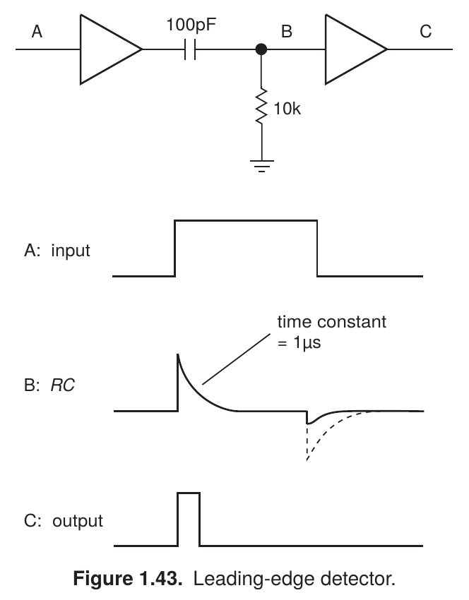

# Leading-edge detector

- **Origin:** reference; recreated in LaTeX.
- **Source:** Paul Horowitz and Winfield Hill, *The Art of Electronics*, third edition (2015), Figure 1.43, printed page 26 (PDF page 59).
- **User feedback:** liked as an integrated circuit-and-signal illustration. The user gave positive feedback on the recreation's appearance.
- **Recreation:** source and rendered preview available. Visual approval does not approve every implementation choice as a shared rule.

[Gallery page](README.md) · [Editable LaTeX source](drawing.tex)

## Original caption

> **Figure 1.43.** Leading-edge detector.

Caption transcribed from the supplied reference. It is also present in the existing recreated figure.

## What it demonstrates

Two buffer symbols, a coupling capacitor, and a shunt resistor form the circuit. Labels A, B, and C connect circuit points to stacked input, RC, and output waveform panels. A short leader identifies a time-constant feature. Solid and dashed curves distinguish aspects of the illustrated transient.

## User comments

The user explicitly expanded Schematica's scope to include graphs and symbolic representations alongside schematics, without separating related circuit and signal illustrations. This example was requested as a one-to-one LaTeX recreation.

## Inferred lessons to review

- Matching labels connect circuit topology to behavior at particular points.
- Stacked qualitative waveforms can communicate timing without axes and grids when those would add no needed information.
- A short annotation and leader can explain a waveform feature directly.

## Use and implementation limits

Select for combined circuit-and-waveform illustrations. The specific values, signal shapes, and dashed trace belong to this example; do not carry them into a new circuit without checking its behavior. The drawing preserves the reference geometry and is not a numerical simulation.

The source uses editable TikZ paths inside a `circuitikz` environment, including traced symbol geometry. It is a visual reference implementation, not yet a semantic component-based template. Typography uses TeX Gyre Heros as a close substitute. Compile with Tectonic or XeLaTeX with CircuitikZ and `tgheros` available; keep build products outside the example folder. The source and preview are preserved from the reviewed recreation.
