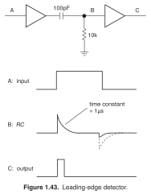

[Schematica](../../../) / [The Art of Electronics](../)

# Leading-edge detector

Shared A/B/C labels connect circuit points to their signals. The circuit and waveforms form one explanation.

SVG: [light](preview-light.svg) / [dark](preview-dark.svg) · [PNG](preview.png) · [LaTeX source](drawing.tex) · [Example notes](EXAMPLE.md)

Original caption and source

> **Figure 1.43.** Leading-edge detector.

Paul Horowitz and Winfield Hill, *The Art of Electronics*, third edition (2015), Figure 1.43, p. 26. The image above is a LaTeX recreation; its caption is retained from the book.

---

[← Gallery](../) · [Previous: Thévenin equivalent circuit](../fig-01-11-thevenin-equivalent/)
