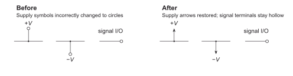

# General schematic preferences

Visual conventions that apply across Schematica styles. Each page holds one accepted rule, its scope, examples, and the correction or evidence behind it. Styles may declare explicit exceptions.

## Supply arrows and hollow signal terminals

**G-SYMBOL-01 · Accepted**

[Open the rule and comparison](supply-and-signal-terminals/README.md)

## Developing the bank

Continue drawing, comparing examples, and giving corrections normally. Agents using Schematica look for reusable lessons and suggest their scope. A correction to one figure stays local unless a broader preference is explicitly accepted. Agents maintain the pages, evidence links, and comparisons after approval; no special preference-building command is required.

The gallery shows accepted preferences with available visuals. [Pending suggestions](GENERAL.md#suggestions-awaiting-a-decision) are separate and do not affect drawing defaults. No ground-symbol preference has been selected yet.

[Agent index and precedence](GENERAL.md) · [Schematica](../README.md)
