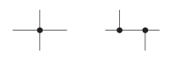
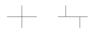
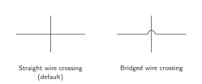
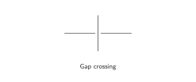
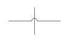

# Connections

Clear wire junctions and connectivity.

<!-- preference-representative: junction-dots/README.md -->
<!-- preference-gallery:start level=2 -->

## [Explicit wire junctions](explicit-wire-junctions/README.md)

Mark every connected T-junction and four-way junction with a solid circle.

<table>
<tr>
<th align="left" width="50%"></th>
<th align="left" width="50%"></th>
</tr>
<tr>
<td align="center" valign="top">

</td>
<td align="center" valign="top">

</td>
</tr>
<tr>
<td valign="top">Both layouts are valid. Every branch connection has a junction circle.</td>
<td valign="top">These branches are intended to connect, but their junction circles are missing.</td>
</tr>
<tr>
<td><a href="explicit-wire-junctions/good.png">PNG</a> · <a href="explicit-wire-junctions/good-light.svg">Light SVG</a> · <a href="explicit-wire-junctions/good-dark.svg">Dark SVG</a></td>
<td><a href="explicit-wire-junctions/bad.png">PNG</a> · <a href="explicit-wire-junctions/bad-light.svg">Light SVG</a> · <a href="explicit-wire-junctions/bad-dark.svg">Dark SVG</a></td>
</tr>
</table>

Ordinary bends and two-branch continuations do not need dots. Use the [junction appearance preference](junction-dots/README.md) for their size and style.

[Editable LaTeX](explicit-wire-junctions/drawing.tex)

## [Junction dots](junction-dots/README.md)

Use solid circles in the wire color, with a diameter ten times the wire width.

<table>
<tr>
<th align="left" width="50%"></th>
<th align="left" width="50%"></th>
</tr>
<tr>
<td align="center" valign="top">

</td>
<td align="center" valign="top">

</td>
</tr>
<tr>
<td valign="top">Solid dots with diameter 10 times the wire width.</td>
<td valign="top">Undersized dots make connected junctions harder to distinguish.</td>
</tr>
<tr>
<td><a href="junction-dots/good.png">PNG</a> · <a href="junction-dots/good-light.svg">Light SVG</a> · <a href="junction-dots/good-dark.svg">Dark SVG</a></td>
<td><a href="junction-dots/bad.png">PNG</a> · <a href="junction-dots/bad-light.svg">Light SVG</a> · <a href="junction-dots/bad-dark.svg">Dark SVG</a></td>
</tr>
</table>

[Editable LaTeX](junction-dots/drawing.tex)

## [Unconnected wire crossings](unconnected-crossings/README.md)

Use uninterrupted crossing wires without a junction circle when there is no connection.

<table>
<tr>
<th align="left" width="50%"></th>
<th align="left" width="50%"></th>
</tr>
<tr>
<td align="center" valign="top">

</td>
<td align="center" valign="top">

</td>
</tr>
<tr>
<td valign="top">Default: straight crossing, no junction circle.</td>
<td valign="top">Do not use a gap to indicate an unconnected crossing.</td>
</tr>
<tr>
<td><a href="unconnected-crossings/good.png">PNG</a> · <a href="unconnected-crossings/good-light.svg">Light SVG</a> · <a href="unconnected-crossings/good-dark.svg">Dark SVG</a></td>
<td><a href="unconnected-crossings/bad.png">PNG</a> · <a href="unconnected-crossings/bad-light.svg">Light SVG</a> · <a href="unconnected-crossings/bad-dark.svg">Dark SVG</a></td>
</tr>
</table>

### Wire bridges

Request **wire bridges** to use this accepted alternative at unconnected crossings.

[PNG](unconnected-crossings/bridge.png) · [Light SVG](unconnected-crossings/bridge-light.svg) · [Dark SVG](unconnected-crossings/bridge-dark.svg)

[Editable LaTeX](unconnected-crossings/drawing.tex)

<!-- preference-gallery:end -->

[All preferences](../README.md) · [Schematica](../../README.md)
