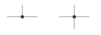
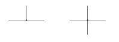

# Connections

Clear wire junctions and connectivity.

<!-- preference-representative: junction-dots/README.md -->
<!-- preference-gallery:start level=2 -->

## [Junction dots](junction-dots/README.md)

Use solid circles in the wire color, with a diameter seven times the wire width.

<table>
<tr>
<th align="left" width="50%"></th>
<th align="left" width="50%"></th>
</tr>
<tr>
<td align="center" valign="top">

</td>
<td align="center" valign="top">

</td>
</tr>
<tr>
<td valign="top">Solid dots with diameter 7 times the wire width.</td>
<td valign="top">Undersized dots make connected junctions harder to distinguish.</td>
</tr>
<tr>
<td><a href="junction-dots/good.png">PNG</a> · <a href="junction-dots/good-light.svg">Light SVG</a> · <a href="junction-dots/good-dark.svg">Dark SVG</a></td>
<td><a href="junction-dots/bad.png">PNG</a> · <a href="junction-dots/bad-light.svg">Light SVG</a> · <a href="junction-dots/bad-dark.svg">Dark SVG</a></td>
</tr>
</table>

[Editable LaTeX](junction-dots/drawing.tex)

<!-- preference-gallery:end -->

[All preferences](../README.md) · [Schematica](../../README.md)
