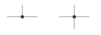
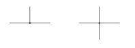

<!-- preference-visual:start -->
# Junction dots

Use solid circles in the wire color, with a diameter five times the wire width.

## 

<!-- preference-good:start -->

<!-- preference-good:end -->

[PNG](good.png) · [Light SVG](good-light.svg) · [Dark SVG](good-dark.svg)

## 

Undersized dots make connected junctions harder to distinguish at normal viewing size.

[PNG](bad.png) · [Light SVG](bad-light.svg) · [Dark SVG](bad-dark.svg)

[Editable LaTeX](drawing.tex)
<!-- preference-visual:end -->

[Connections](../README.md) · [All preferences](../../README.md) · [Rule details](RULE.md)
