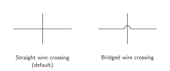
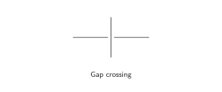

<!-- preference-visual:start -->
# Unconnected wire crossings

Crossing wires remain separate when there is no junction circle.

<!-- preference-comparison:start -->
<table>
<tr>
<th align="left" width="50%"></th>
<th align="left" width="50%"></th>
</tr>
<tr>
<td align="center" valign="top">
<!-- preference-good:start -->

<!-- preference-good:end -->
</td>
<td align="center" valign="top">
<!-- preference-bad:start -->

<!-- preference-bad:end -->
</td>
</tr>
<tr>
<td valign="top">Both styles are valid. Use either name as a keyword; <strong>wire bridges</strong> also selects the bridged style.</td>
<td valign="top">Do not use a gap to indicate an unconnected crossing.</td>
</tr>
<tr>
<td><a href="good.png">PNG</a> · <a href="good-light.svg">Light SVG</a> · <a href="good-dark.svg">Dark SVG</a></td>
<td><a href="bad.png">PNG</a> · <a href="bad-light.svg">Light SVG</a> · <a href="bad-dark.svg">Dark SVG</a></td>
</tr>
</table>
<!-- preference-comparison:end -->

[Editable LaTeX](drawing.tex)
<!-- preference-visual:end -->

[Connections](../README.md) · [All preferences](../../README.md) · [Rule details](RULE.md)
