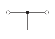

<!-- preference-visual:start -->
# Wire thickness

Use 0.65 pt wires at the drawing's native scale, retaining the junction and terminal proportions.

## 

<!-- preference-good:start -->

<!-- preference-good:end -->

[PNG](good.png) · [Light SVG](good-light.svg) · [Dark SVG](good-dark.svg)

[Editable LaTeX](drawing.tex)
<!-- preference-visual:end -->

[Connections](../README.md) · [All preferences](../../README.md) · [Rule details](RULE.md)
