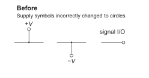
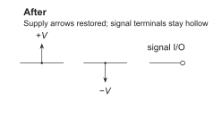

# Supply arrows and hollow signal terminals

**G-SYMBOL-01 · Accepted general preference · 08-11-2026**

| Before | After |
| --- | --- |
|  |  |

## Rule

Use **arrows for supply-rail connections** and **hollow circles for exposed signal input/output terminals**. Keep these symbol roles distinct. A request to change signal-terminal appearance does not change supply symbols.

## Scope and exceptions

Apply this preference across schematic styles, unless the current request or a documented style exception explicitly changes the relevant symbol. Follow the [precedence guide](../GENERAL.md#apply-preferences).

This rule does not choose ground symbols, junction dots, current-direction arrows, or connector-pin symbols. Arrow direction in this example follows the rail layout; a negative supply is not required to point down in every drawing. No universal font size, line weight, or terminal size is established here.

## What the correction teaches

In the output-stage trial, the user requested hollow signal terminals. The agent also changed the supply arrows to circles. The user corrected that broader interpretation: supply symbols should retain their distinct convention. **Apply a correction to the intended electrical role, not every similarly shaped endpoint.**

The two images are focused illustrations of that correction, reconstructed for this preference page; they are not historical screenshots or full copies of the trial circuit. Only the supply symbols differ. The rejected feature is the supply-circle substitution, not the entire earlier drawing.

The rule and its visual documentation were approved through the [output-stage discussion and visual-bank decision](../../context/LOG.md#visual-preference-bank). The comparison was compiled and visually checked by the agent; approval of the rule does not imply user approval of every drawing parameter.

[Before SVG](before.svg) · [After SVG](after.svg) · [Combined comparison](comparison.svg) · [Transparent PNG](comparison.png) · [Editable LaTeX](drawing.tex) · [Export script](render.py)

[Back to preference gallery](../README.md) · [Agent index and precedence](../GENERAL.md) · [Schematica](../../README.md)
