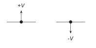
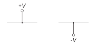

# Symbols

Distinct symbols for supplies and signal terminals.

<!-- preference-representative: power-supply-arrows/README.md -->
<!-- preference-gallery:start level=2 -->

## [Power supply arrow symbols](power-supply-arrows/README.md)

Use arrows to identify power-supply connections.

### ✅ Good

[PNG](power-supply-arrows/good.png) · [Light SVG](power-supply-arrows/good-light.svg) · [Dark SVG](power-supply-arrows/good-dark.svg)

### ❌ Bad

Supply connections shown as circles obscure their distinct role.

[PNG](power-supply-arrows/bad.png) · [Light SVG](power-supply-arrows/bad-light.svg) · [Dark SVG](power-supply-arrows/bad-dark.svg)

[Editable LaTeX](power-supply-arrows/drawing.tex)

## [Input/output terminal circles](signal-terminal-circles/README.md)

Use hollow circles for exposed signal inputs and outputs.

### ✅ Good

[PNG](signal-terminal-circles/good.png) · [Light SVG](signal-terminal-circles/good-light.svg) · [Dark SVG](signal-terminal-circles/good-dark.svg)

[Editable LaTeX](signal-terminal-circles/drawing.tex)

<!-- preference-gallery:end -->

[All preferences](../README.md) · [Schematica](../../README.md)
