# Symbols

Distinct symbols for supplies and signal terminals.

<!-- preference-representative: power-supply-arrows/README.md -->
<!-- preference-gallery:start level=2 -->

## [Power supply arrow symbols](power-supply-arrows/README.md)

Use arrows to identify power-supply connections.

<table>
<tr>
<th align="left" width="50%"></th>
<th align="left" width="50%"></th>
</tr>
<tr>
<td align="center" valign="top">

</td>
<td align="center" valign="top">

</td>
</tr>
<tr>
<td valign="top">Arrows identify the supply connections.</td>
<td valign="top">Circles obscure the distinct role of supply connections.</td>
</tr>
<tr>
<td><a href="power-supply-arrows/good.png">PNG</a> · <a href="power-supply-arrows/good-light.svg">Light SVG</a> · <a href="power-supply-arrows/good-dark.svg">Dark SVG</a></td>
<td><a href="power-supply-arrows/bad.png">PNG</a> · <a href="power-supply-arrows/bad-light.svg">Light SVG</a> · <a href="power-supply-arrows/bad-dark.svg">Dark SVG</a></td>
</tr>
</table>

[Editable LaTeX](power-supply-arrows/drawing.tex)

## [Input/output terminal circles](signal-terminal-circles/README.md)

Use hollow circles for exposed signal inputs and outputs.

### 

[PNG](signal-terminal-circles/good.png) · [Light SVG](signal-terminal-circles/good-light.svg) · [Dark SVG](signal-terminal-circles/good-dark.svg)

[Editable LaTeX](signal-terminal-circles/drawing.tex)

<!-- preference-gallery:end -->

[All preferences](../README.md) · [Schematica](../../README.md)
