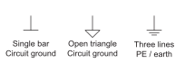

<!-- preference-visual:start -->
# Circuit ground and protective earth

Use a single bar or an open triangle for circuit ground. Reserve the three-line symbol for PE/earth. Set the common symbol width to 25 times the wire thickness, with matching strokes.

## 

<!-- preference-good:start -->

<!-- preference-good:end -->

The triangle is twice as wide as it is high. PE bars have lengths in a 3:2:1 ratio, with equal spacing of one sixth of the longest bar. Dimensions follow stroke centre lines.

[PNG](good.png) · [Light SVG](good-light.svg) · [Dark SVG](good-dark.svg)

[Editable LaTeX](drawing.tex)
<!-- preference-visual:end -->

[Symbols](../README.md) · [All preferences](../../README.md) · [Rule details](RULE.md)
