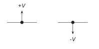
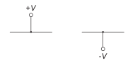

<!-- preference-visual:start -->
# Power supply arrow symbols

Use arrows to identify power-supply connections.

## ✅ Good

<!-- preference-good:start -->

<!-- preference-good:end -->

[PNG](good.png) · [Light SVG](good-light.svg) · [Dark SVG](good-dark.svg)

## ❌ Bad

Supply connections shown as circles obscure their distinct role.

[PNG](bad.png) · [Light SVG](bad-light.svg) · [Dark SVG](bad-dark.svg)

[Editable LaTeX](drawing.tex)
<!-- preference-visual:end -->

[Symbols](../README.md) · [All preferences](../../README.md) · [Rule details](RULE.md)
