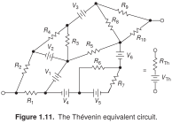
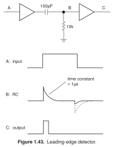

[← The Art of Electronics](../README.md)

# All examples

31 references · 5 saved recreations · 26 records awaiting images.

## [Schematics](schematics/README.md)

Circuits and conceptual connection diagrams. 15 examples.

## [Plots and signal sketches](plots/README.md)

Standalone waveforms and annotated signals. 1 example.

[Figure 4.62 · Clamp output glitches](plots/fig-04-62-clamp-output-glitches/EXAMPLE.md) — image not saved yet.

## [Mixed illustrations](mixed/README.md)

Circuits combined with waveforms, equations, blocks, or physical illustrations. 15 examples.

[Showcase](../README.md) · [Detailed inventory](../STYLE.md#example-guide)
