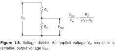
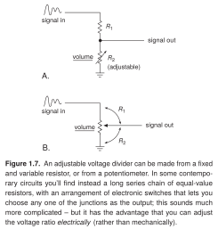
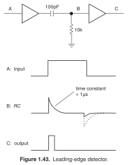

[← All examples](../README.md) · [Showcase](../../README.md)

# Mixed illustrations

Circuits combined with waveforms, equations, blocks, or physical illustrations.

15 examples · 3 saved previews.

### [Voltage divider · Figure 1.6](fig-01-06-voltage-divider/)

A circuit, voltage annotations, and an equation explain one relationship.

---

### [Adjustable voltage divider · Figure 1.7](fig-01-07-adjustable-divider/)

Small signal sketches and control annotations clarify two alternative circuits.

---

### [Leading-edge detector · Figure 1.43](fig-01-43-leading-edge-detector/)

Matching circuit labels and waveform panels connect structure to behavior.

---

## Reference notes

Images for these references are not saved in the repository yet.

- [Figure 1.68 · Regulated dc power supply](fig-01-68-regulated-dc-power-supply/EXAMPLE.md)
- [Figure 1.139 · Oscilloscope probe](fig-01-139-oscilloscope-probe/EXAMPLE.md)
- [Figure 2.29 · Complementary followers](fig-02-29-complementary-followers/EXAMPLE.md)
- [Figure 2.64 · Differential amplifier performance](fig-02-64-differential-amplifier-performance/EXAMPLE.md)
- [Figure 2.68 · Loudspeaker amplifier](fig-02-68-loudspeaker-amplifier/EXAMPLE.md)
- [Figure 4.7 · Amplifiers for ac signals](fig-04-07-ac-signal-amplifiers/EXAMPLE.md)
- [Figure 4.63 · Active full-wave rectifier](fig-04-63-active-full-wave-rectifier/EXAMPLE.md)
- [Figure 4.80 · Single-supply photometer](fig-04-80-single-supply-photometer/EXAMPLE.md)
- [Figure 4.105 · Output amplifier for a 60 Hz power source](fig-04-105-power-source-amplifier/EXAMPLE.md)
- [Figure 5.64 · Inherently differential signals](fig-05-64-differential-signals/EXAMPLE.md)
- [Figure 5.77 · Three-op-amp instrumentation amplifier](fig-05-77-instrumentation-amplifier/EXAMPLE.md) — image import pending
- [Figure 5.78 · Signal guarding](fig-05-78-signal-guarding/EXAMPLE.md) — image import pending

[← All examples](../README.md) · [Showcase](../../README.md)
