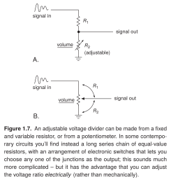

[Schematica](../../../../../) / [The Art of Electronics](../../../)

# Adjustable voltage divider

Small waveform sketches describe the input locally; the two panels compare ways to control the output.

SVG: [light](preview-light.svg) / [dark](preview-dark.svg) · [PNG](preview.png) · [LaTeX source](drawing.tex) · [Example notes](EXAMPLE.md)

Original caption and source

> **Figure 1.7.** An adjustable voltage divider can be made from a fixed and variable resistor, or from a potentiometer. In some contemporary circuits you'll find instead a long series chain of equal-value resistors, with an arrangement of electronic switches that lets you choose any one of the junctions as the output; this sounds much more complicated – but it has the advantage that you can adjust the voltage ratio *electrically* (rather than mechanically).

Paul Horowitz and Winfield Hill, *The Art of Electronics*, third edition (2015), Figure 1.7, p. 7. The image above is a LaTeX recreation; its caption is retained from the book.

---

[← Category](../README.md) · [Showcase](../../../README.md) · [Previous: Voltage divider](../fig-01-06-voltage-divider/) · [Next: Thévenin equivalent circuit →](../../schematics/fig-01-11-thevenin-equivalent/)
