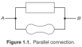
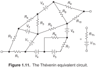

[← All examples](../README.md) · [Showcase](../../README.md)

# Schematics

Circuits and conceptual connection diagrams.

15 examples · 2 saved previews.

### [Parallel connection · Figure 1.1](fig-01-01-parallel-connection/)

Abstract shapes make the connection itself the subject.

---

### [Thévenin equivalent circuit · Figure 1.11](fig-01-11-thevenin-equivalent/)

A complex network and its compact equivalent share one composition.

---

## Reference notes

Images for these references are not saved in the repository yet.

- [Figure 1.67 · Voltage multipliers](fig-01-67-voltage-multipliers/EXAMPLE.md)
- [Figure 1.83 · Inductive kick](fig-01-83-inductive-kick/EXAMPLE.md)
- [Figure 1.84 · Blocking inductive kick](fig-01-84-blocking-inductive-kick/EXAMPLE.md)
- [Figure 2.25 · AC-coupled emitter follower](fig-02-25-ac-coupled-emitter-follower/EXAMPLE.md)
- [Figure 2.66 · Single-ended dc amplifier](fig-02-66-single-ended-dc-amplifier/EXAMPLE.md)
- [Figure 2.78 · Sziklai-pair power stage](fig-02-78-sziklai-pair-power-stage/EXAMPLE.md)
- [Figure 3.111 · Low-power piezo driver](fig-03-111-piezo-driver/EXAMPLE.md)
- [Figure 4.13 · FET–bipolar current source](fig-04-13-fet-bipolar-current-source/EXAMPLE.md)
- [Figure 4.29 · Voltage regulator](fig-04-29-voltage-regulator/EXAMPLE.md)
- [Figure 4.58 · Op-amp peak trackers](fig-04-58-peak-trackers/EXAMPLE.md)
- [Figure 4.61 · Active clamp](fig-04-61-active-clamp/EXAMPLE.md)
- [Figure 4.73 · Op-amp split-supply generator](fig-04-73-split-supply-generator/EXAMPLE.md)
- [Figure 4.87 · Laboratory dc amplifier](fig-04-87-laboratory-dc-amplifier/EXAMPLE.md)

[← All examples](../README.md) · [Showcase](../../README.md)
